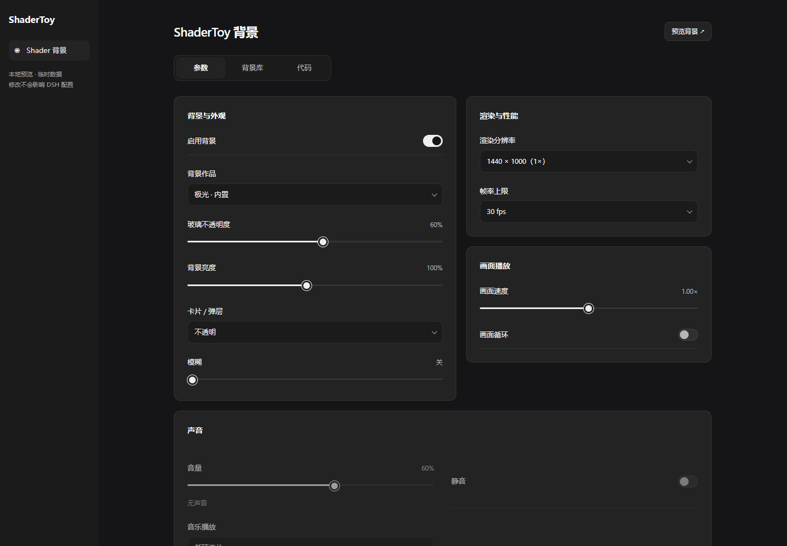
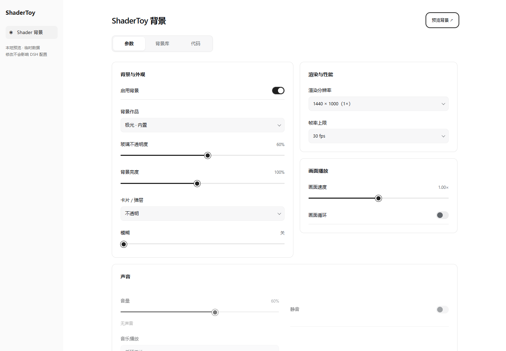
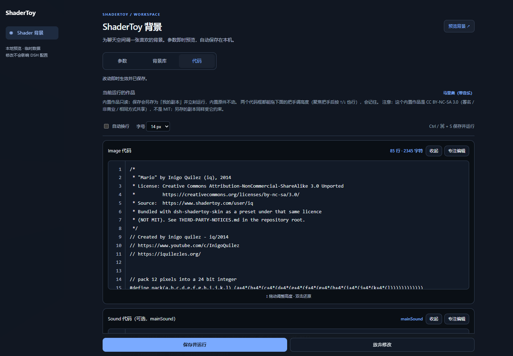
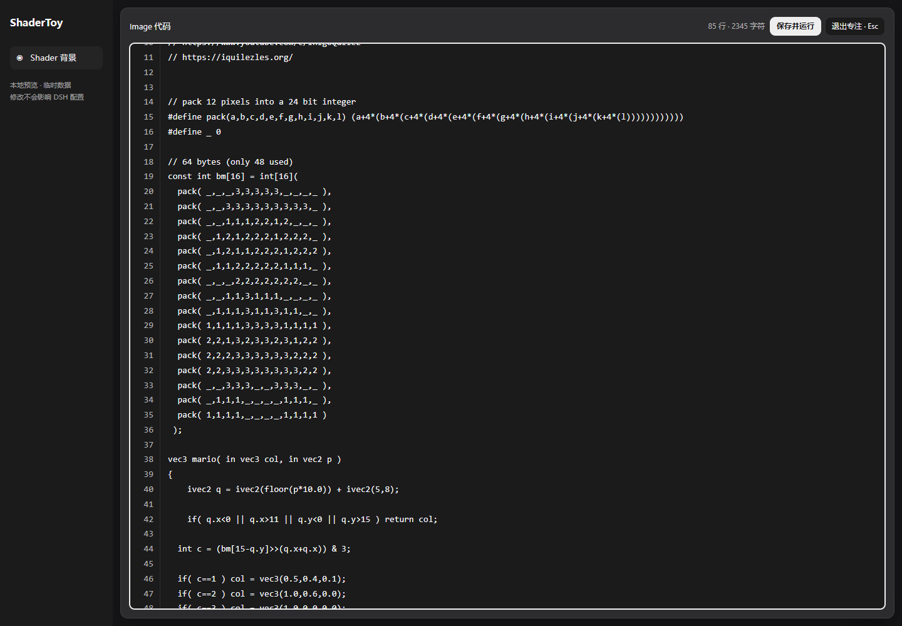
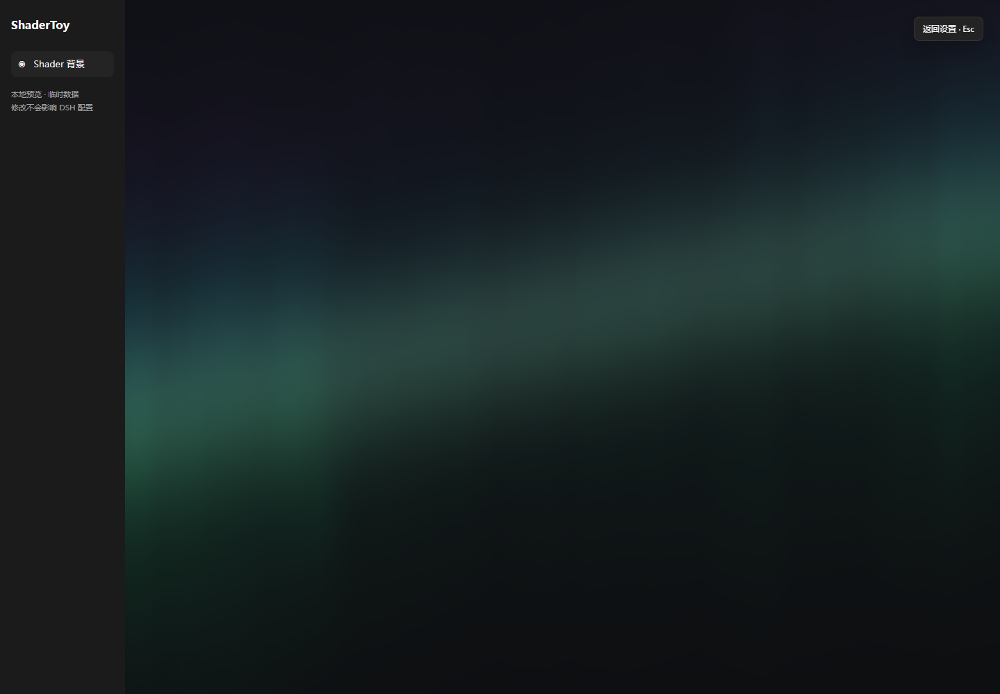

# 设置页与代码工作区更新 · 2026-10-27

三个功能分支均直接基于 `origin/main`，可以分别审查、合并。原本地 `main` 保留；本目录当前在用于组合预览的 `codex/preview`。

| 分支 | 工作目录 | 内容 |
|---|---|---|
| `codex/settings-ui` | `D:/AI_workspace/dsh-shadertoy-worktrees/settings-ui` | 分组卡片、深浅色可读表面、开关/滑块/下拉、键盘导航、共用状态提示、背景预览、窄窗口适配 |
| `codex/code-editor` | `D:/AI_workspace/dsh-shadertoy-worktrees/code-editor` | 整行拖动条与边缘滚动、4000 px 高度上限、双击还原、行号、字号、换行、收起、专注编辑与保存 |
| `codex/core-fixes` | `D:/AI_workspace/dsh-shadertoy-worktrees/core-fixes` | 作品切换、保存、导入、草稿和渲染/音频修复，见[核心审查](core-review-2026-10-27.md) |

## 本地体验

在项目目录运行 `npm run preview`，打开 `http://127.0.0.1:8735/`。它运行真实的插件 Client、设置页和 WebGL 播放器，用一个小型适配器提供 DSH 的必要接口，状态存入单独的临时目录。不会修改已安装插件或现有 DSH 配置。

主设置页提供稳定的可读表面；「预览背景」临时收起设置，查看当前作品与参数效果，Esc 返回。代码区可单独进入专注编辑，保留阅读位置，支持鼠标保存或 Ctrl/⌘+S。未保存草稿只在当前页面会话内保留，刷新前应保存。

## 验证结果

- `npm test`：109 项包检查、Host 路由与状态验证（含 24 个并发保存）。
- `npm run test:renderer`：真实 Edge / WebGL2 渲染、回退、面板、拖动、代码保存、滚动验证。
- `npm run test:audio`：真实 WebAudio 非静音样本、调度、音量、只播一次与循环验证。
- `npm run test:panel`：真实 Client / 面板 / 播放器组合验证，覆盖请求竞争、保存失败与重试、草稿、Common 导入、编译失败保留旧画面。
- `npm run test:ui`：双栏/单栏、主题、键盘、背景预览、声音控件、编辑器展开/收起/专注、阅读位置、字号/换行/高度记忆、390 px 布局；生成下列截图。

测试环境为 Windows + Edge，使用软件 WebGL 确认可复现。完整 DSH 桌面版的侧栏与服务生命周期仍需安装后做一次人工验收；本次没有发布 npm 或修改已安装插件。多 pass / 纹理输入仍不支持。

## 截图

窄窗口截图：[参数](verify/ui-refresh/settings-narrow.png)、[背景库](verify/ui-refresh/library-narrow.png)、[代码](verify/ui-refresh/editor-narrow.png)。
